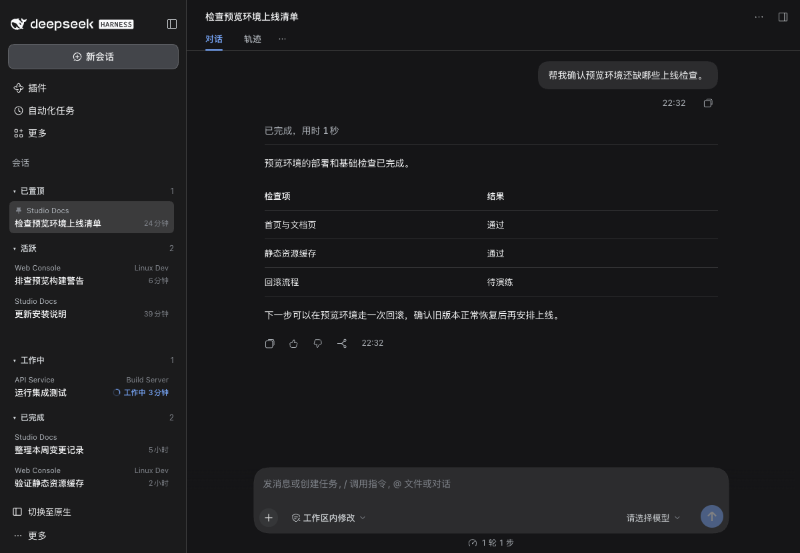

# Session Harbor

[](https://github.com/TengYangTuoHai/dsh-session-harbor/actions/workflows/ci.yml)

在一个 DeepSeek Harness 窗口里管理本机和多台 SSH 设备的会话。侧栏按「已置顶」「活跃」「工作中」「已完成」分组，点开远端会话就能在主区域继续对话。

[直接安装](#直接安装) · [连接 SSH 设备](#连接-ssh-设备) · [版本发布](https://github.com/TengYangTuoHai/dsh-session-harbor/releases/latest) · [报告问题](https://github.com/TengYangTuoHai/dsh-session-harbor/issues/new?template=bug-report.yml)



*开发版实机界面，使用示例会话和设备。*

## 直接安装

**插件 v0.2.6** 支持 DeepSeek Harness `0.2.2-rc.3` 和 `0.2.2-rc.5`。

1. 在 DSH 左侧打开「插件」，点击「添加插件」。
2. 在「包名或地址」输入以下包名，点击「安装」。

   ```text
   dsh-session-harbor
   ```

3. 安装完成后点「立即启用」。如果 DSH 提示重启，重启后再打开工作台。

如果镜像还没同步，在「安装源 → 自定义地址」填入 `https://registry.npmjs.org/`，再按包名安装。也可以在同一个输入框使用 GitHub Release 的 `.tgz` 下载链接。[npm 包](https://www.npmjs.com/package/dsh-session-harbor) · [Release 安装包](https://github.com/TengYangTuoHai/dsh-session-harbor/releases/latest)

从旧版「T3 会话侧边栏」升级时，先在「插件」页卸载旧版，再安装 Session Harbor。现有会话、置顶、已完成状态和已保存的 SSH 主机可继续使用。

更新 Session Harbor 时，在插件详情中使用 DSH 提供的「更新」。如果当前版本通过 `.tgz` 安装且 DSH 未提供更新入口，先卸载，再用包名重新安装。

## 管理会话

- **切换会话。** 点击列表中的本机或 SSH 会话继续对话。远端会话右上角显示设备名。
- **查看待处理事项。** 等待审批或问答的会话排在「活跃」组顶部，展开「工作中」可查看正在运行的任务。
- **整理会话。** 右键置顶、重命名或标为已完成。新建会话在首轮对话开始后进入列表。

用侧栏底部的「切换至原生」按钮可切回 DSH 原生列表。

## 连接 SSH 设备

1. 在「设置 → Session Harbor SSH」点击「添加主机」，从本机 SSH 配置选择主机，或输入 `user@host`。
2. 点击「添加并连接」。连接就绪后，该设备的会话会出现在侧栏。
3. 点击已有会话继续对话，或点 DeepSeek Harness 左上角的「新会话」，在输入区上方选择设备和项目。

SSH 登录沿用本机 OpenSSH 配置和 SSH agent。**打开远端原生会话需要远端安装与本机相同版本的 DSH。** 要在本机标记远端会话为「已完成」并同步该状态，也请在远端安装本插件。

安装或连接遇到问题时，可以附上版本信息和复现步骤。[报告问题](https://github.com/TengYangTuoHai/dsh-session-harbor/issues/new?template=bug-report.yml)

## 从源码安装

在仓库根目录执行以下命令安装依赖、构建及验证。

```sh
npm --prefix dsh-session-harbor ci
node tools/build-client.mjs
node tools/build-client.mjs --check
node --test dsh-session-harbor/*.test.js
```

在 DSH「添加插件」里输入 `dsh-session-harbor/` 的绝对路径并启用。

[插件说明](dsh-session-harbor/README.md) · [远端会话设计](docs/remote-aggregation-design.md) · [维护者发版流程](docs/releasing.md)

## 许可

本项目采用 MIT 许可。侧栏分组和会话行参考 T3 Code 的 `095611d1` 实现（MIT，© T3 Tools Inc.）。[LICENSE](LICENSE) · [T3 Code](https://github.com/pingdotgg/t3code/tree/095611d1)
